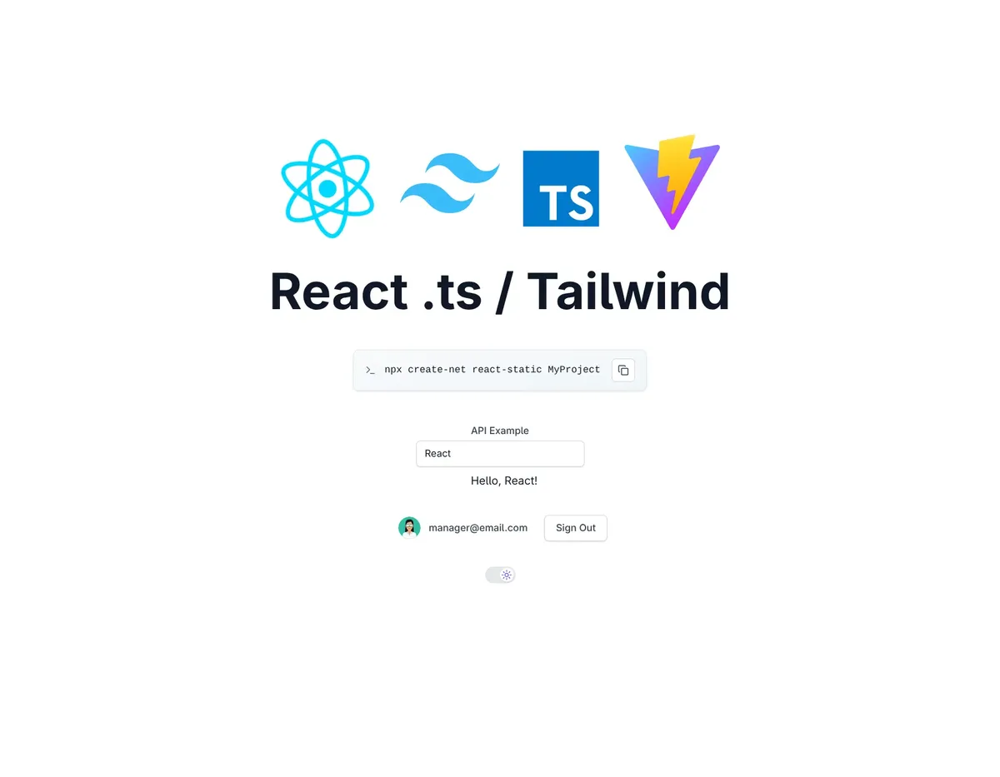
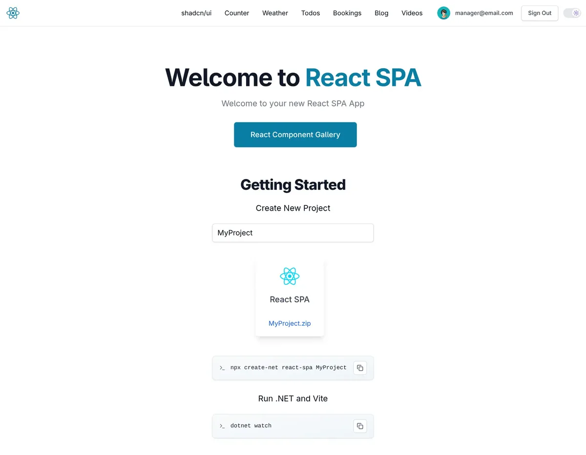
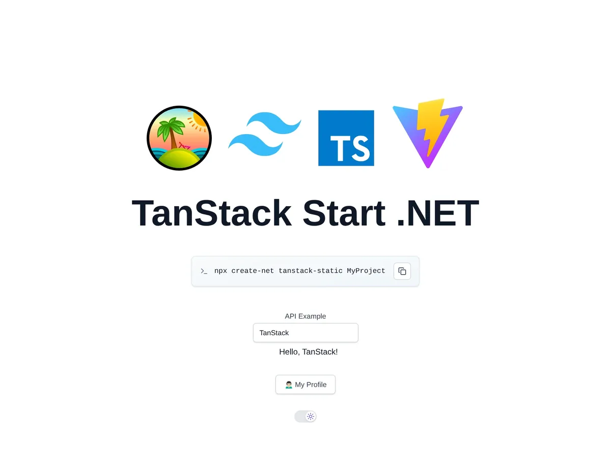
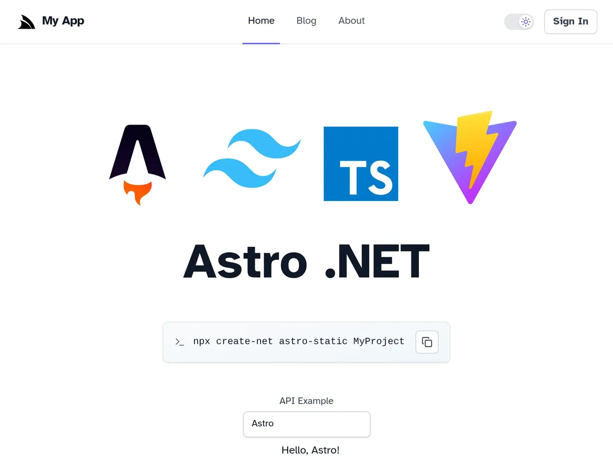
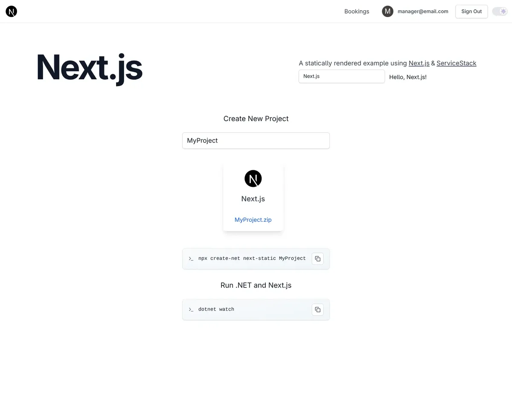
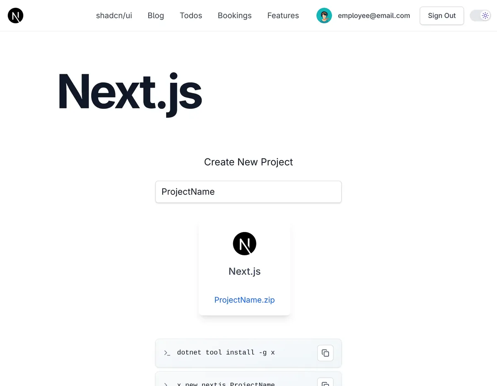
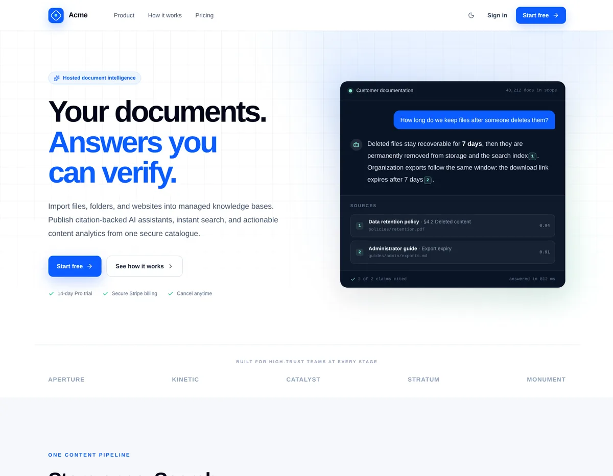
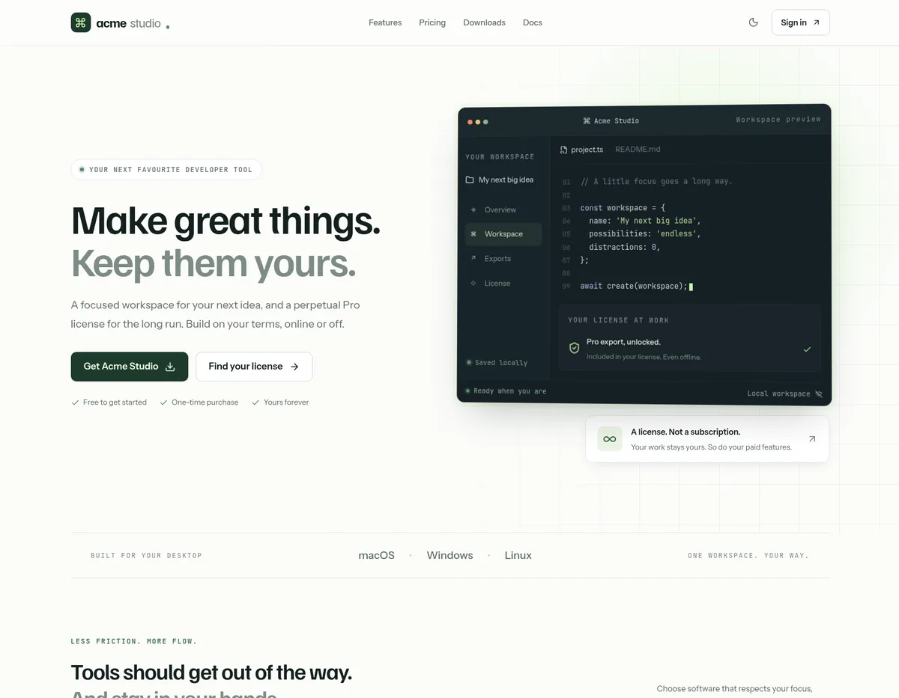

:::youtube POVYVwCZRYU
React, Next.js and Vue on .NET: Unified toolchain with Vite+
:::

A modern front-end project quietly collects tools before you write your first line of code. A dev server and a
bundler. A linter with its plugins and its own config file. A type checker run as a separate step. A test runner
with another config file. Each has its own CLI, its own dependencies and its own upgrade schedule, and each one is
somewhere a template can drift out of date.

In **ServiceStack v10.5**, every React, Next.js and Vue project template replaces that stack with
[Vite+](https://viteplus.dev), the unified JavaScript toolchain from [VoidZero](https://voidzero.dev), the team
behind Vite, Vitest, Rolldown and Oxc.

## One CLI, one config

Vite+ gives you a single `vp` CLI to develop, build, lint, format, type check and test, all configured from a single
`vite.config.ts`:

| Task | Before | Command | Now |
|-|-|-|-|
| Dev Server & Build | Vite 7 (Rollup + esbuild) | `vp dev` / `vp build` | Vite 8 (Rolldown) |
| Linting | ESLint 9 + plugins | `vp lint` | Oxlint, type-aware |
| Formatting | none | `vp fmt` | Oxfmt |
| Type Checking | `tsc` (TypeScript 5) | `vp check` | TypeScript Go (TypeScript 7 in React) |
| Testing | Vitest 4 | `vp test` | Vitest |
| All checks | multiple tools & configs | `vp check` | format + lint + types in one pass |

Lint, format and test settings now live next to your dev server and build config, replacing the separate
`eslint.config.js` and `vitest.config.ts` files, with a lot fewer `devDependencies` to keep up to date:

```ts
import { defineConfig, lazyPlugins } from 'vite-plus'
import react from '@vitejs/plugin-react'
import tailwindcss from '@tailwindcss/vite'

export default defineConfig({
    // lazyPlugins skips loading plugins for `vp check/lint/fmt`
    plugins: lazyPlugins(() => [react(), tailwindcss()]),
    test: {
        environment: 'happy-dom',
        include: ['src/**/*.test.{ts,tsx}'],
    },
    lint: {
        plugins: ['oxc', 'typescript', 'unicorn', 'react'],
        categories: { correctness: 'error' },
        rules: {
            'typescript/no-explicit-any': 'error',
            'react/rules-of-hooks': 'error',
            'react/exhaustive-deps': 'warn',
            // new in Oxlint's correctness category, not in the previous ESLint config
            'typescript/no-floating-promises': 'warn',
        },
        options: {
            typeAware: true,
            typeCheck: true, // replaces `tsc -b`
        },
    },
    fmt: {
        semi: false,
        singleQuote: true,
        tabWidth: 4,
        printWidth: 160,
    },
})
```

## One check for everything

The command you'll run most is `npm run check`. It formats, lints and type checks your entire front-end in a single
pass:

:::sh
npm run check
:::

Oxlint runs type-aware rules powered by TypeScript Go, and the React, Next.js, TanStack Start and Astro templates
are on **TypeScript 7**, so there's no separate `tsc` step to remember. Vue templates use `vue-tsc` to type check
their `.vue` Single File Components.

Oxlint, Oxfmt and the Rolldown bundler are built on [Oxc](https://oxc.rs), a Rust-based toolchain that VoidZero
describes as orders of magnitude faster than ESLint and Prettier, whilst Vite 8's Rolldown replaces both Rollup and
esbuild for production builds. The new type-aware rules also catch more real bugs than the ESLint config they
replace, e.g. `no-floating-promises` flags an `async` call whose errors would otherwise be silently lost.

## Who builds what

Vite+ checks, lints, formats and tests every template. Whether it also runs the dev server and production build
depends on the framework:

| Templates | Dev server & build | Check, lint, format & test |
|-|-|-|
| `react-static`, `react-spa`, `tanstack-static` | Vite+ (`vp dev`, `vp build`) | Vite+ |
| `vue-static`, `vue-spa` | Vite+ (`vp dev`, `vp build`) | Vite+, with `vue-tsc` for `.vue` files |
| `next-static`, `next-rsc`, `nextjs`, `next-saas`, `next-license` | Next.js | Vite+ |
| `astro-static` | Astro | Vite+ |

Either way you get the same commands and the same rules, so moving between templates, or between projects built
from different templates, doesn't mean learning a different toolchain.

## The same scripts in every template

Every template now shares the same npm scripts, run from its `MyApp.Client` folder:

```bash
npm run dev         # Start the dev server
npm run check       # Format + lint + type check
npm run lint        # Lint with Oxlint
npm run fmt         # Format with Oxfmt
npm run test        # Run tests in watch mode
npm run test:ui     # Run tests with the Vitest UI
npm run test:run    # Run tests once
npm run outdated    # Check for outdated dependencies
npm run upgrade     # Upgrade dependencies
```

Day to day you'll usually just run `dotnet watch`, which starts your .NET App and the front-end dev server together.
`vp` is installed locally as a dev dependency, so every script works out of the box without a global install. To run
`vp` commands directly you can optionally install its global CLI:

:::copy
curl -fsSL https://vite.plus | bash
:::

## One code style, for people and AI Agents

Every template is now formatted with Oxfmt. The code you start from, the code you write and the code your AI Agent
writes all end up with the same style, so diffs only show the changes that matter. The commit that applied the new
formatting is listed in `.git-blame-ignore-revs`, so `git blame` still points at the change that last touched each
line rather than at the reformat.

## Your editor, set up

Each template also includes a `MyApp.code-workspace` VS Code Workspace, which you can open from
**File > Open Workspace from File...** or with:

:::copy
code MyApp.code-workspace
:::

It adds the `MyApp.Client` front-end as its own root folder alongside your .NET solution, so you can develop, run and
debug both your UI and your C# App from the same sidebar, with each root getting its own tooling:

- **Format & fix on save** - JS and TS files (and `.vue` files) are formatted with Oxfmt and auto-fixed with Oxlint
  on save, using the same `vite.config.ts` rules as `vp check` and CI, whilst C# and Razor files keep their own
  formatters
- **Recommended extensions** - VS Code offers to install the Vite+ Extension Pack (Oxc + Vitest) and the C# Dev Kit,
  plus the TypeScript 7 Native Preview language server for React and Next.js templates, or Vue (Official) for Vue
  templates
- **Integrated testing** - run and debug both your Vitest front-end tests and your NUnit .NET tests from VS Code's
  Testing sidebar

## The same rules in CI and for your AI Agent

The GitHub Actions workflow in each template uses the same toolchain. It sets up Vite+ with cached dependencies and
runs a `client` job on every push that checks, tests and builds your front-end:

```yaml
client:
  runs-on: ubuntu-latest
  steps:
    - uses: actions/checkout@v7

    - name: Setup Vite+ and install npm dependencies
      uses: voidzero-dev/setup-vp@v1.22.0
      with:
        node-version: '24'
        working-directory: ./MyApp.Client
        cache: true

    - name: check (format, lint, type check)
      run: vp check
      working-directory: ./MyApp.Client

    - name: test
      run: vp test run
      working-directory: ./MyApp.Client

    - name: build
      run: vp build
      working-directory: ./MyApp.Client
```

Each template's `AGENTS.md` has been updated as well, so an AI Agent working in your project knows to validate its
changes with `npm run check` and `vp test`, and that `dtos.ts` is regenerated automatically when your .NET App starts.
The rules that format your code on save are the same rules CI enforces and the same rules your agent checks against,
so a change that passes in one place passes in all three.

## The template lineup

Every one of these templates now uses Vite+, including two new templates in this release:

<div class="not-prose my-8 grid gap-x-6 gap-y-10 sm:grid-cols-2">
  <a href="https://react-static.react-templates.net" class="group flex flex-col">
    
    <div class="mt-3 font-semibold text-gray-900 dark:text-gray-100">react-static</div>
    <div class="mt-1 text-sm text-gray-600 dark:text-gray-400">Minimal React SPA statically generated by Vite</div>
  </a>
  <a href="https://react-spa.react-templates.net" class="group flex flex-col">
    
    <div class="mt-3 font-semibold text-gray-900 dark:text-gray-100">react-spa</div>
    <div class="mt-1 text-sm text-gray-600 dark:text-gray-400">Full-featured React SPA with Blog, Todos, shadcn/ui, API Keys & AI Chat</div>
  </a>
  <a href="https://tanstack-static.react-templates.net" class="group flex flex-col">
    
    <div class="mt-3 font-semibold text-gray-900 dark:text-gray-100">tanstack-static <span class="ml-1 rounded bg-indigo-600 px-1.5 py-0.5 text-xs text-white">NEW</span></div>
    <div class="mt-1 text-sm text-gray-600 dark:text-gray-400">Statically prerendered TanStack Start App with type-safe routing</div>
  </a>
  <a href="https://astro-static.react-templates.net" class="group flex flex-col">
    
    <div class="mt-3 font-semibold text-gray-900 dark:text-gray-100">astro-static <span class="ml-1 rounded bg-indigo-600 px-1.5 py-0.5 text-xs text-white">NEW</span></div>
    <div class="mt-1 text-sm text-gray-600 dark:text-gray-400">Statically generated Astro site with a Markdown/MDX Blog & React islands</div>
  </a>
  <a href="https://next-static.react-templates.net" class="group flex flex-col">
    
    <div class="mt-3 font-semibold text-gray-900 dark:text-gray-100">next-static</div>
    <div class="mt-1 text-sm text-gray-600 dark:text-gray-400">Statically exported Next.js App with a .NET API</div>
  </a>
  <a href="https://nextjs.react-templates.net" class="group flex flex-col">
    
    <div class="mt-3 font-semibold text-gray-900 dark:text-gray-100">nextjs</div>
    <div class="mt-1 text-sm text-gray-600 dark:text-gray-400">Full-featured Next.js App with MDX Blog, Todos, shadcn/ui & AI Chat</div>
  </a>
  <a href="https://next-saas.react-templates.net" class="group flex flex-col">
    
    <div class="mt-3 font-semibold text-gray-900 dark:text-gray-100">next-saas</div>
    <div class="mt-1 text-sm text-gray-600 dark:text-gray-400">Production-ready SaaS with individual & business accounts, roles, billing & quotas</div>
  </a>
  <a href="https://next-license.react-templates.net" class="group flex flex-col">
    
    <div class="mt-3 font-semibold text-gray-900 dark:text-gray-100">next-license</div>
    <div class="mt-1 text-sm text-gray-600 dark:text-gray-400">Sell one-time licenses that unlock Pro features in .NET or Electron Apps</div>
  </a>
</div>

The Next.js templates also include `next-rsc` for React Server Components calling .NET APIs on the server, and we
introduced [next-saas](/posts/next-saas) and [next-license](/posts/next-license) in earlier posts. For Vue there are
`vue-static` and the full-featured `vue-spa`.

**TanStack Start** gives you a prerendered React App with fully type-safe routing, and **Astro** is for content-first
sites like blogs, docs and marketing pages that ship no JavaScript by default. We'll take a closer look at each of
them in the next two posts.

## Start one

Pick a template and enter your project name to copy the command to create it, or download it as a ready-to-run .zip:

<vite-plus-templates></vite-plus-templates>

Existing projects can adopt the same setup by following the [Vite+ guide](https://react-templates.net/docs/vite-plus),
and the [v10.5 Release Notes](https://docs.servicestack.net/releases/v10_05#react-next.js-vue-templates-upgraded-to-vite)
cover the full list of changes.
