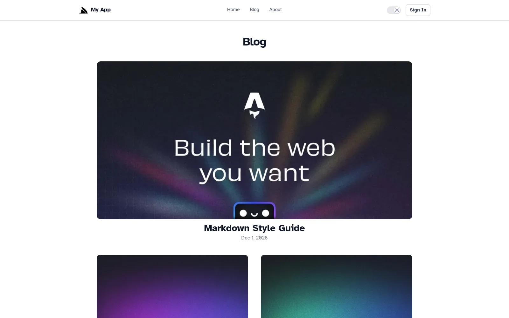
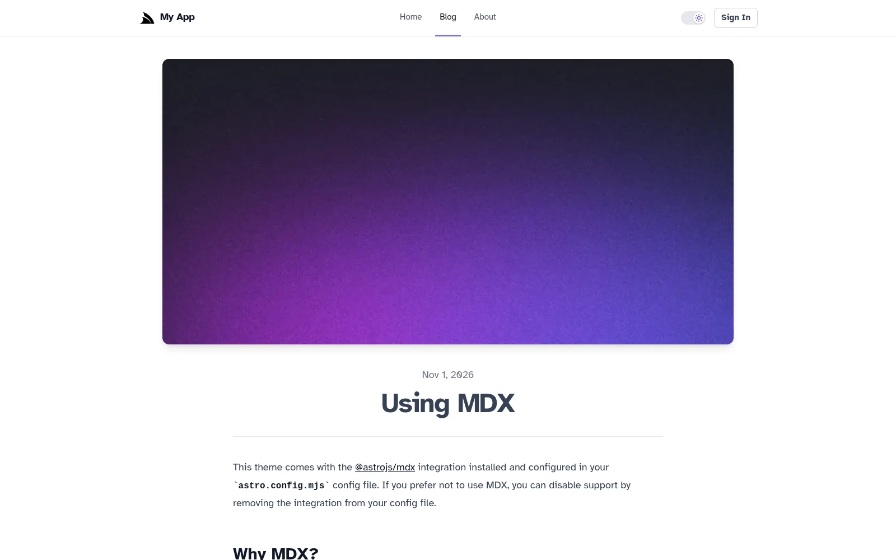

:::youtube 1pQ6fe62_s0
Astro + .NET: Static HTML Pages, React Islands, No Node.js Server
:::

Most of a blog, a docs site or a product page is just content: a header, an article and a footer. Yet many React
sites ship a whole JavaScript framework to the browser to render it, then wait for it to load before the page becomes
usable.

**ServiceStack v10.5** adds a new template built on [Astro](https://astro.build), the web framework for
content-driven websites. It's for content-first Apps like blogs, docs, marketing and product sites that still need
interactive features, ServiceStack APIs and authentication from a .NET backend:

:::sh
npx create-net astro-static MyProject
:::

<div class="not-prose my-8 grid gap-4 sm:grid-cols-2">
  <a href="https://github.com/NetCoreTemplates/astro-static" class="block rounded-lg border border-gray-200 dark:border-gray-700 p-4 hover:border-indigo-400">
    <div class="font-semibold text-gray-900 dark:text-gray-100">astro-static</div>
    <div class="text-sm text-gray-600 dark:text-gray-400">Source code on GitHub</div>
  </a>
  <a href="https://astro-static.react-templates.net" class="block rounded-lg border border-gray-200 dark:border-gray-700 p-4 hover:border-indigo-400">
    <div class="font-semibold text-gray-900 dark:text-gray-100">astro-static.react-templates.net</div>
    <div class="text-sm text-gray-600 dark:text-gray-400">Live Demo</div>
  </a>
</div>

## No JavaScript until a component needs it

Astro renders each page to HTML and CSS at build time. A React component without a `client:*` directive is rendered
to static HTML too, and none of its JavaScript is sent to the browser. Pages stay small and load fast, with great SEO
and Core Web Vitals scores, without you having to optimize for them.

## Islands, hydrated when you choose

When a component does need to be interactive, you make it an **island** and choose when it loads:

| Directive | Hydrates |
|-|-|
| `client:load` | Immediately, on page load |
| `client:visible` | When it's scrolled into view |
| `client:idle` | When the browser is idle |
| `client:only` | Only in the browser, without being prerendered |

On the template's home page the install command is static HTML, whilst the API example next to it is an island that
calls a ServiceStack API as you type:

```astro
---
import { ShellCommand } from 'react-net-templates'
import { HelloApi } from '../components/islands'
import Layout from '../layouts/Layout.astro'
---

<Layout>
    <!-- Rendered to static HTML at build time, with no JS -->
    <ShellCommand>npx create-net astro-static MyProject</ShellCommand>

    <!-- Interactive React island, hydrated in the browser -->
    <HelloApi client:load value="Astro" />
</Layout>
```

## Many islands, one signed-in user

Each island is its own React root, so islands on the same page don't share React context. The template wraps each
interactive component with `withApp()`, which gives it the ServiceStack `ClientContext` for calling your APIs. The
first island to hydrate loads the App's metadata and the signed-in user, which every island on the page then shares:

```tsx
import { withApp } from '@/lib/app'
import { appAuth } from '@/lib/auth'
import HelloApiComponent from './HelloApi'

export const HelloApi = withApp(HelloApiComponent)

/** Sign in link, or the signed-in user's avatar linking to their profile */
export const UserMenu = withApp(function UserMenu() {
    const { user, ready } = appAuth()
    if (!ready) return <span className="inline-block h-8 w-8" />
    //...
})
```

A user menu in the header, a profile button on the page and an API example further down can all show the same
signed-in user, loaded once.

## Write in Markdown, checked at build time

Content is Markdown and MDX. Blog posts live in a
[Content Collection](https://docs.astro.build/en/guides/content-collections/), where every post's frontmatter is
validated against a typed schema:

```ts
import { defineCollection } from 'astro:content'
import { glob } from 'astro/loaders'
import { z } from 'astro/zod'

const blog = defineCollection({
    // Load Markdown and MDX files in the `src/content/blog/` directory.
    loader: glob({ base: './src/content/blog', pattern: '**/*.{md,mdx}' }),
    // Type-check frontmatter using a schema
    schema: ({ image }) =>
        z.object({
            title: z.string(),
            description: z.string(),
            pubDate: z.coerce.date(),
            updatedDate: z.coerce.date().optional(),
            heroImage: z.optional(image()),
        }),
})

export const collections = { blog }
```

Forget a title or mistype a date, and the build fails and tells you which post is wrong, instead of publishing a
broken page. Your content team gets the safety of a type checker without leaving Markdown.

The blog comes complete with an index page, a page per post, an RSS feed at `/rss.xml` and a generated sitemap:

<div class="not-prose my-8 grid gap-4 sm:grid-cols-2">
  
  
</div>

## Just HTML, plus components

An `.astro` component is an HTML template with a small script at the top that runs at build time. There are no React
Server Components, no `"use client"` boundaries and no server/client component rules to learn, which makes pages
simple to reason about and easier for AI Agents to get right.

React is fully supported through the `@astrojs/react` integration, so you can reuse your existing React components and
the [@servicestack/react](https://react.servicestack.net) component library. Astro's official integrations for MDX,
RSS, sitemaps and optimized images are already configured.

## One .NET App, in development and in production

The template uses the same hybrid development model as our other templates:

- **Development** - `dotnet watch` starts both your .NET App and the Astro dev server, with ASP.NET Core proxying page
  requests to Astro, which renders each page on request. React islands update in place with HMR, whilst changes to
  `.astro` and Markdown files reload the page
- **Production** - `npm run build` prerenders every page to HTML, e.g. `/blog/first-post` becomes
  `blog/first-post.html`, which is published to `MyApp/wwwroot` and served with clean URLs, with any unknown path
  returning the prerendered `404.html`

There's no Node.js server to deploy, run or secure in production. Static output is Astro's default rather than an
export mode with features to avoid, so there are no unsupported APIs to work around, and your site deploys as part of
your .NET App with the template's existing Docker and [Kamal deployments](https://react-templates.net/docs/deployments).

## The rules of a static site

No server means a few clear rules:

- **Frontmatter runs at build time** - the script at the top of an `.astro` file runs when the site is built, so
  per-user data and authenticated APIs are called from React islands in the browser instead
- **Dynamic pages are listed at build time** - routes like `blog/[...slug].astro` list every page with
  `getStaticPaths()`, so data that changes at runtime is fetched from a ServiceStack API in an island:

```astro
---
import { getCollection, render } from 'astro:content'
import BlogPost from '../../layouts/BlogPost.astro'

export async function getStaticPaths() {
    const posts = await getCollection('blog')
    return posts.map((post) => ({ params: { slug: post.id }, props: post }))
}

const post = Astro.props
const { Content } = await render(post)
---

<BlogPost {...post.data}>
    <Content />
</BlogPost>
```

- **Pages are prerendered signed out** - pages that depend on the signed-in user render their island with
  `client:only`, e.g. the auth-protected profile page:

```astro
---
import { Profile } from '../components/islands'
import Layout from '../layouts/Layout.astro'
---

<Layout title="Profile">
    <!-- client:only: the profile depends on the signed-in user, so it's only rendered in the browser -->
    <Profile client:only="react" />
</Layout>
```

These rules are also written into the template's `AGENTS.md`, so an AI Agent knows which Astro features to use and
which to avoid.

## Everything else you'd expect

It's still a full ServiceStack App:

- **ASP.NET Core Identity Auth** - sign in, sign up and account management, with an auth-protected `/profile` page
- **React 19 islands** calling typed ServiceStack APIs with `JsonServiceClient`
- **Dark Mode** - with a toggle that remembers the user's preference
- **AutoQuery CRUD** - the same Bookings APIs as our other templates, managed from the built-in
  [Admin UI](https://docs.servicestack.net/admin-ui) and explored in the [API Explorer](https://docs.servicestack.net/api-explorer)
- **[Vite+](/posts/vite-plus-templates)** for formatting, linting, type checking and testing

## Start one

Content pages that are just HTML, React islands where you need them, Markdown that's checked before it's published,
and nothing but your .NET App to run in production:

:::sh
npx create-net astro-static MyProject
:::

Read more in the [astro-static docs](https://react-templates.net/docs/templates/astro-static) and the
[v10.5 Release Notes](https://docs.servicestack.net/releases/v10_05#new-astro-template).
