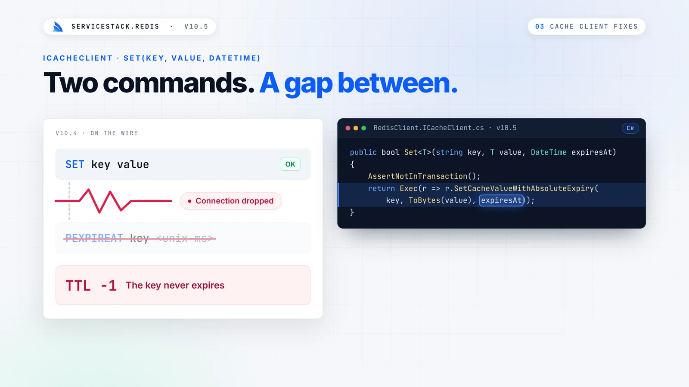
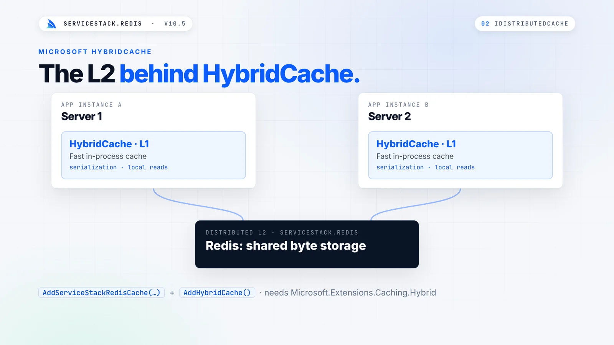
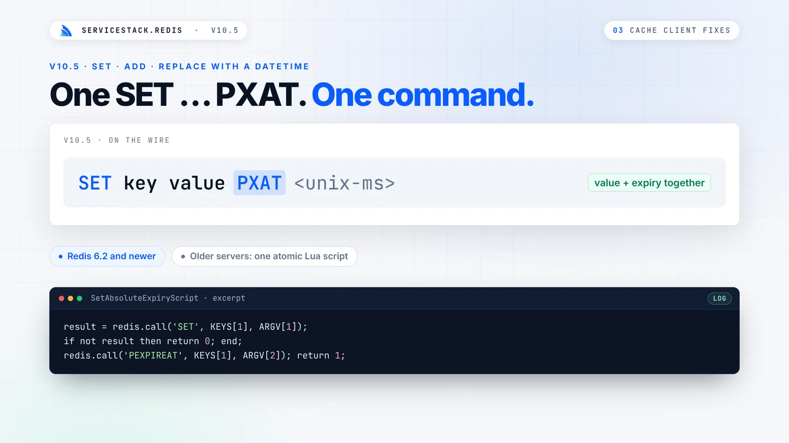
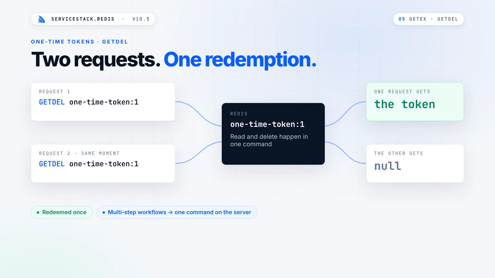
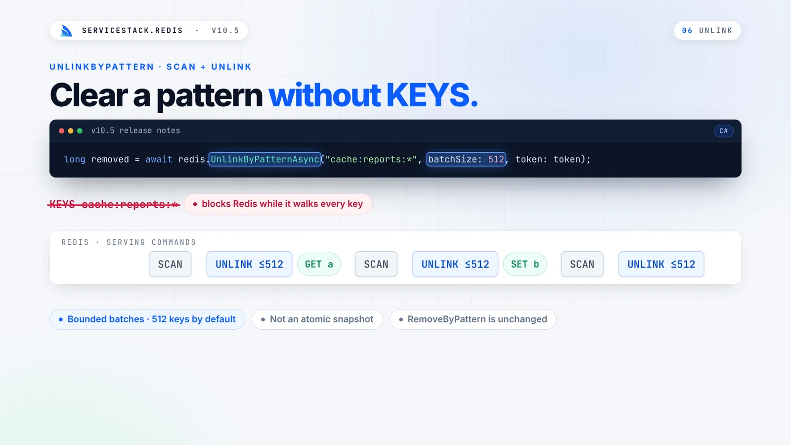
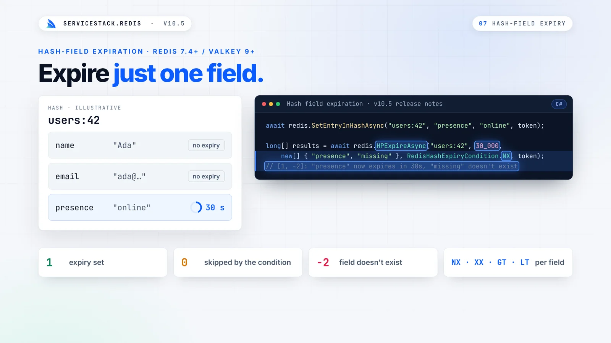
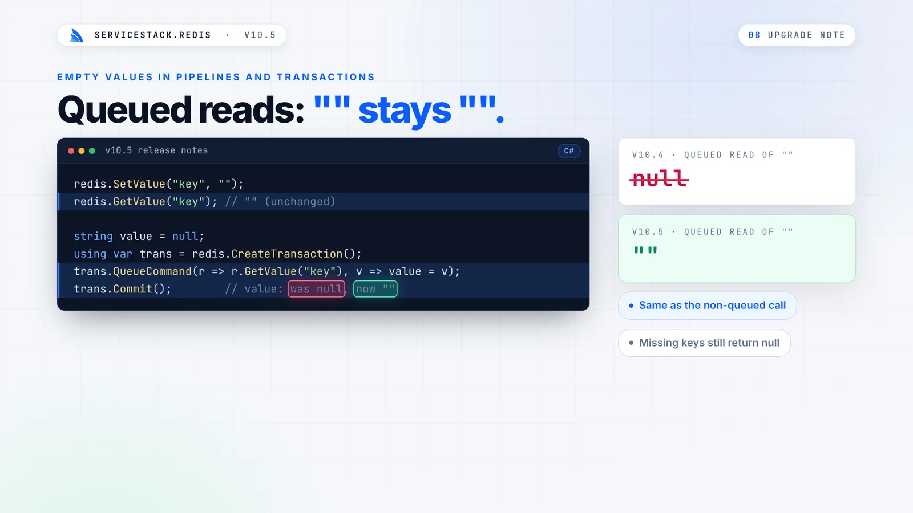

:::youtube bb5ThR6ZV9w
Redis Caching in .NET: IDistributedCache, HybridCache and Atomic TTLs
:::

Caching is simple: store a value, give it a lifetime, read it back. The part you can't see is the lifetime. If a value
is written with one command and its expiry is set with a second, a dropped connection or a concurrent write between
the two leaves a key with the wrong expiry, or none at all:



Nothing throws. Your App keeps working while it serves stale data, or slowly fills Redis with keys that never expire.

**ServiceStack.Redis v10.5** closes that gap. Every value and its expiry are written together in one atomic step, and
on .NET 10 that same guarantee now sits behind Microsoft's standard caching APIs.

## Your Redis behind IDistributedCache

On **.NET 10**, ServiceStack.Redis can back Microsoft's `IDistributedCache`, so ASP.NET Core features and libraries
that use the standard caching abstractions store their data in your Redis with one call:

```csharp
builder.Services.AddServiceStackRedisCache("localhost:6379", options => {
    options.KeyPrefix = "myapp:cache:v1:";
});
```

If you already register an `IRedisClientsManager`, the cache reuses its connection pool instead of opening another:

```csharp
builder.Services.AddSingleton<IRedisClientsManager>(c => new RedisManagerPool("localhost:6379"));
builder.Services.AddServiceStackRedisCache();
```

There's no extra package to install. The adapter and its Microsoft dependencies are only included in the `net10.0`
build of ServiceStack.Redis, so Apps on `net472`, `net6.0` and `net8.0` don't take on any new dependencies. Values
are stored as raw bytes, so empty values are kept as they are.

### The L2 behind HybridCache

It also works as the distributed L2 cache for Microsoft's
[HybridCache](https://learn.microsoft.com/en-us/aspnet/core/performance/caching/hybrid):

```csharp
builder.Services.AddServiceStackRedisCache("localhost:6379");
builder.Services.AddHybridCache();
```



HybridCache handles serialization and the fast in-process L1 inside each server, whilst Redis provides the shared L2
byte storage. Each server's L1 is independent, and there's no invalidation backplane between them, so choose L1
lifetimes you're happy to serve.

### Absolute and sliding expiration, enforced together

`IDistributedCache` supports an absolute deadline and a sliding window that extends on every read. When you use both,
the window must stop at the deadline. ServiceStack.Redis runs `Set`, `Get` and `Refresh` as single Lua scripts that
check the value, the sliding window and the absolute deadline together, so a concurrent refresh can never push an
entry past its absolute expiration:

```csharp
await cache.SetStringAsync("status", "ready", new DistributedCacheEntryOptions {
    AbsoluteExpirationRelativeToNow = TimeSpan.FromMinutes(10),
    SlidingExpiration = TimeSpan.FromMinutes(2)
}, token);
```

The scripts are cached on the server and run by their SHA1 hash, so each call sends only its arguments. It requires
Redis 5+ (or Valkey) with permission to run `EVAL` and `EVALSHA`.

## Expiries you already set, fixed

If you use ServiceStack's `ICacheClient`, v10.5 fixes expiry issues you might not have known you had:

- **`Set`, `Add` and `Replace` with a `DateTime`** wrote the value, then sent a separate command to set its expiry.
  They now send one `SET key value PXAT <unix-ms>` on Redis 6.2+, and one atomic Lua script on older servers.
- **Async `AddAsync` and `ReplaceAsync` with a `TimeSpan`** didn't pass their expiry to Redis at all, so those keys
  were stored without a TTL. They now set it the same way as their sync versions.



There's nothing to change in your code to get the fix: the same calls now apply their expiries atomically.

## Read and expire, read and delete

Reading a session and extending its lifetime usually takes two round trips, and redeeming a one-time token with a
read and then a delete leaves a gap where two requests can both redeem it. v10.5 adds Redis's atomic key commands:

| API | Redis Command | Description |
|-|-|-|
| `GetAndExpireValue` | `GETEX` | Return a value and update its expiration in one command |
| `GetAndDeleteValue` | `GETDEL` | Return a value and delete it in one command |
| `Unlink` | `UNLINK` | Remove keys immediately, freeing their memory in the background |

```csharp
using var redis = redisManager.GetClient();

// Sliding sessions: read it and push its expiry back in one command
string session = redis.GetAndExpireValue("session:1", new RedisGetExOptions { ExpirySeconds = 20 * 60 });

// One-time tokens: only one request can ever get the value
string token = redis.GetAndDeleteValue("one-time-token:1");
```



Even if two identical requests reach Redis at the same millisecond, `GETDEL` guarantees only one of them gets the
token. `GETEX` and `GETDEL` require Redis 6.2+.

## Clear large keys and patterns without stalling Redis

Deleting a large key with `DEL` blocks Redis's main thread while it frees the memory, so every other client waits.
`Unlink` removes the key from the keyspace immediately and reclaims its memory in the background:

```csharp
long removed = redis.Unlink("large:key", "another:key");
```

To clear every key matching a pattern, the new `UnlinkByPattern` walks the keyspace with a `SCAN` cursor instead of
the blocking `KEYS` command, and removes what it finds in bounded `UNLINK` batches, so other clients' commands keep
running in between:

```csharp
long removed = await redis.UnlinkByPatternAsync("cache:reports:*", batchSize: 512, token: token);
```



## Expire a single field in a hash

Hashes keep related values together under one key, like a user's profile. Until Redis 7.4, every field in a hash
shared the key's lifetime. On Redis 7.4+ or Valkey 9+, each field can now expire on its own schedule:

```csharp
await redis.SetEntryInHashAsync("users:42", "presence", "online", token);

long[] results = await redis.HPExpireAsync("users:42", 30_000,
    new[] { "presence", "missing" }, RedisHashExpiryCondition.NX, token);
// [1, -2]: "presence" now expires in 30s, "missing" doesn't exist
```



The user's name and email stay, whilst their online presence expires 30 seconds after their last heartbeat. Each call
returns one status code per field, so you can tell which were updated, which were missing and which were skipped by an
`NX`, `XX`, `GT` or `LT` condition, and expiring a field never changes the lifetime of the hash itself.

That's all it takes to show who's online in a chat room, with each member disappearing on their own when their
heartbeats stop:

```csharp
public void Heartbeat(string room, string userId, TimeSpan ttl)
{
    redis.SetEntryInHash(room, userId, DateTime.UtcNow.ToString("O"));
    redis.HPExpire(room, (long)ttl.TotalMilliseconds, new[] { userId });
}

List<string> online = redis.GetHashKeys("presence:room:42");
```

Absolute expiry suits access that ends at a known time, like a 14-day trial feature, where the `GT` condition makes
sure an extension can never cut an existing grant short:

```csharp
redis.SetEntryInHash($"grants:user:{userId}", "export-reports", "trial");
redis.HExpireAt($"grants:user:{userId}", DateTimeOffset.UtcNow.AddDays(14).ToUnixTimeSeconds(),
    new[] { "export-reports" }, RedisHashExpiryCondition.GT);
```

## Patterns for a cache that stays fast

Alongside v10.5 we've added new [Redis Use-Cases](https://docs.servicestack.net/redis/use-cases) docs, with tested
recipes for common problems. Three from [Caching Patterns](https://docs.servicestack.net/redis/caching-patterns) build
directly on atomic expiry.

### Stop cache stampedes

When a popular key expires, every request that misses at the same moment rebuilds the value, and a query that
normally runs once runs hundreds of times at once. Let only one caller rebuild it, using an atomic `SET NX` with an
expiry as a short-lived lock:

```csharp
public static T GetOrCreateOnce<T>(this IRedisClient redis, string key, TimeSpan expireIn,
    Func<T> createFn, TimeSpan? waitFor = null) where T : class
{
    var value = redis.Get<T>(key);
    if (value != null) return value;

    var lockKey = key + ":rebuilding";
    var waitUntil = DateTime.UtcNow + (waitFor ?? TimeSpan.FromSeconds(5));
    while (DateTime.UtcNow < waitUntil)
    {
        // Only the caller that creates the lock key rebuilds the value
        if (redis.SetValueIfNotExists(lockKey, "1", TimeSpan.FromSeconds(30)))
        {
            try
            {
                value = createFn();
                redis.Set(key, value, expireIn);
                return value;
            }
            finally
            {
                redis.RemoveEntry(lockKey);
            }
        }

        Thread.Sleep(50); // Everyone else waits for the rebuilt value
        value = redis.Get<T>(key);
        if (value != null) return value;
    }
    return createFn(); // The rebuild is taking too long, fall back to loading it ourselves
}
```

In our tests, 20 concurrent callers hitting an expired key ran the rebuild exactly once, and all 20 received the
rebuilt value.

### Invalidate related entries together

Record each cached key in a Redis Set for each tag it belongs to, then remove a whole group atomically with a small
Lua script that `UNLINK`s its members:

```csharp
const string InvalidateTagLua = """
    local keys = redis.call('SMEMBERS', KEYS[1])
    for i = 1, #keys, 500 do
        redis.call('UNLINK', unpack(keys, i, math.min(i + 499, #keys)))
    end
    redis.call('UNLINK', KEYS[1])
    return #keys
    """;

redis.ExecLuaAsInt(InvalidateTagLua, new[] { "tag:category:tools" }, Array.Empty<string>());
```

When a whole namespace goes stale at once, such as after a catalog import, put a generation number in each key and
invalidate everything with a single `INCR`, letting the old entries expire on their own.

### A two-tier cache across servers

For small, very hot values, keep a short-lived copy in each server's memory and use Redis Pub/Sub to tell every server
to evict its copy when the value changes. The [two-tier cache recipe](https://docs.servicestack.net/redis/caching-patterns#two-tier-cache-with-pubsub-invalidation)
combines a `MemoryCacheClient`, Redis and a managed `RedisPubSubServer` in one class.

## Distributed rate limiting with the same guarantee

The same gap that loses cache expiries also breaks naive rate limiting. `INCR` a counter, then `EXPIRE` it, and a
process that dies between the two leaves a counter that never resets, locking that caller out until someone deletes
the key. Running both in one Lua script makes them atomic:

```csharp
public const string FixedWindowLua = """
    local count = redis.call('INCR', KEYS[1])
    if count == 1 then
        redis.call('PEXPIRE', KEYS[1], ARGV[1])
    end
    return count
    """;
```

ASP.NET Core's [rate limiting](/posts/rate-limiting) keeps its counters in each server's memory, so behind a load
balancer every server enforces its own limit. With the counters in Redis, a limit of 100 requests a minute means 100
in total, however many servers handle them. A global request filter applies it to every ServiceStack API:

```csharp
appHost.GlobalRequestFiltersAsync.Add(async (req, res, requestDto) =>
{
    var redisManager = req.TryResolve<IRedisClientsManagerAsync>();
    await using var redis = await redisManager.GetClientAsync();

    var session = await req.GetSessionAsync();
    var caller = session.IsAuthenticated ? $"user:{session.UserAuthId}" : $"ip:{req.RemoteIp}";
    var key = $"ratelimit:{requestDto.GetType().Name}:{caller}";

    var count = await redis.ExecLuaAsIntAsync(FixedWindowLua, new[] { key }, new[] { "60000" });
    if (count > 100)
    {
        res.AddHeader("Retry-After", "60");
        throw new HttpError(429, "TooManyRequests", "Rate limit exceeded, try again later");
    }
});
```

[Distributed Rate Limiting](https://docs.servicestack.net/redis/rate-limiting) also covers sliding windows for exact
limits on logins and password resets, and token buckets that allow short bursts.

## One change to check before upgrading

All new APIs are additive, and there's one behavior change to check. Reading an empty string in a pipeline or
transaction now returns `""` instead of `null`, matching what the same call returns outside a pipeline:



If you check queued results with `value == null`, switch to `string.IsNullOrEmpty(value)`. Missing keys still return
`null`. To keep the old behavior while you review your code, set this at startup:

```csharp
RedisConfig.PipelineEmptyValuesAsNull = true;
```

## Upgrade today

With v10.5 your Redis serves both ServiceStack's cache and ASP.NET Core's caching APIs, with expiries that do what you
set even under concurrency and dropped connections. See the docs for the details:

- [IDistributedCache & HybridCache](https://docs.servicestack.net/redis/distributed-cache)
- [Hash Field Expiration](https://docs.servicestack.net/redis/hash-field-expiration)
- [Caching Patterns](https://docs.servicestack.net/redis/caching-patterns)
- [Distributed Rate Limiting](https://docs.servicestack.net/redis/rate-limiting)
- [v10.5 Release Notes](https://docs.servicestack.net/releases/v10_05#servicestack.redis)
